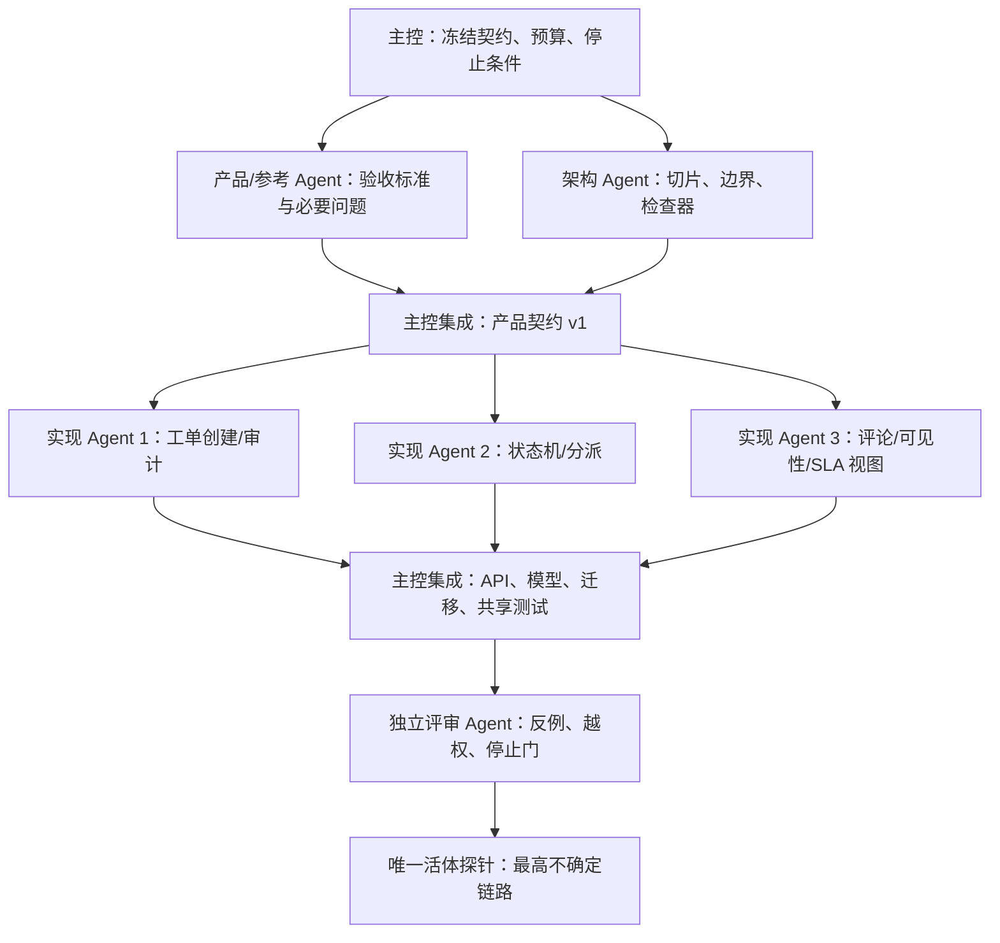

# TASK-302 架构与实现模拟报告

- Goal ID：GOAL-REFERENCE-DRIVEN-PRODUCT-ENGINEERING
- 阶段：PHASE-03
- 生成时间：2026-07-30T18:50:00+08:00
- 输入：`goal-master.md`、`reference-report-201.md`、`product-contract-v1.md`、`phase-01-baseline-contract.md`
- 边界：未联网；未安装；未修改 Guyue 核心；未读取 TASK-301 产出；未实现真实产品
- 结论：DONE_WITH_CONCERNS

## 1. 工程模拟结论

从架构与实现角度，通用 B2B 工单协作系统不能被拆成“先做页面、再补后端”的横向任务。首版最小闭环应按纵向切片交付：每个切片同时覆盖数据模型、后端权限、状态变化、审计、API、UI 可见性和定向测试。

古月在本 Goal 中应扮演主控编排器，而不是直接把所有事情塞进一个万能 Skill。合理链路是：

1. 主控冻结产品契约和非目标。
2. 参考/产品 Agent 把外部机制转成验收标准。
3. 架构/实现 Agent 拆纵向切片、边界和检查器。
4. 生产 Agent 分别拥有低耦合切片。
5. 主控集成跨切片耦合点。
6. 独立评审用契约、检查器和最小探针反证。

主要担忧有三项：

- PHASE-01 已显示复合目标没有直接路由入口，说明“参考研究 + 需求澄清 + 多 Agent + 独立验收”的主链目前不能假设自动稳定。
- 多 Agent 可以并行调查和设计，但权限模型、状态机、审计语义、API 契约必须集中收束，否则会出现每个切片局部正确、整体不可用。
- 模拟和同模型评审只能提供结构证据，不能证明真实产品能力；唯一活体探针应优先测试编排入口或契约到检查器的落地能力。

## 2. 架构切片

### S0：控制与契约切片

目标：把自然语言目标固定成可执行契约，防止实现过程中扩张。

- 输入：产品契约 v1、参考矩阵、非目标、成本边界。
- 产物：需求决定表、角色权限表、状态机表、API 面、验收标准映射。
- 关键接口：所有实现切片必须引用同一组状态、角色和审计事件名称。
- 不可并行点：状态枚举、角色定义、客户可见状态映射不能由各 Agent 自行定义。

### S1：工单创建与审计切片

用户价值：用户能创建请求，系统留下可追溯记录。

- 数据：`ticket`、`audit_event`。
- 后端：创建工单时强制初始状态为“新建”或“待分派”，并写创建审计。
- API：`POST /tickets`、`GET /tickets/{id}`。
- UI：创建表单、详情页基础信息。
- 测试：创建后状态合法；审计事件存在；必填字段校验；客户只能看到自己的请求。
- 风险：若只做前端假数据，会违反“列表筛选必须来自真实数据查询或模拟数据源”的验收要求。

### S2：分派与队列切片

用户价值：主管能把工单分给团队或处理人，处理人能看到自己的工作。

- 数据：`assignee_id`、`team_id`、`priority`、`due_at`。
- 后端：分派权限只允许管理员/主管，处理人只能在授权范围内查看和更新。
- API：`PATCH /tickets/{id}/assignment`、`GET /tickets?view=mine|team|risk`。
- UI：团队队列、我的工单、负责人选择、优先级标识。
- 测试：无权限分派被拒绝；团队过滤来自查询；分派写审计。
- 风险：前端隐藏按钮不是权限控制，只能作为体现；后端必须拒绝越权请求。

### S3：状态机与重开切片

用户价值：工单按可解释流程推进，不能任意跳转。

- 状态：新建、待分派、处理中、等待客户、内部等待、已解决、已关闭。
- 后端：集中状态转换服务，拒绝非法跳转。
- API：`POST /tickets/{id}/transitions`。
- UI：详情页状态动作区，仅展示当前用户可执行动作。
- 测试：不能从新建直接到已关闭；已解决收到客户回复可回到处理中；已关闭后不修改原工单而创建跟进工单。
- 风险：若各 API 自行改 `status` 字段，会绕过状态机和审计。

### S4：评论、内部备注与客户可见性切片

用户价值：客户沟通和内部协作分离，避免泄露。

- 数据：`comment`，字段包含 `visibility=public|internal`。
- 后端：客户只能读写公开评论；内部备注只对内部授权角色可见。
- API：`POST /tickets/{id}/comments`、`GET /tickets/{id}/comments`。
- UI：公开评论与内部备注分 Tab 或明显分区。
- 测试：客户接口不返回内部备注；内部备注写审计；公开评论可触发等待客户/处理中转换规则。
- 风险：评论列表若只在前端过滤，接口仍会泄露内部备注。

### S5：SLA 风险与列表视图切片

用户价值：团队能优先处理临近或逾期工单。

- 数据：`due_at`、`priority`、派生 `sla_risk=normal|near_due|overdue`。
- 后端：查询时按当前时间计算或持久化刷新风险级别。
- API：`GET /tickets?view=risk`、排序和筛选参数。
- UI：逾期风险视图、列表徽标和排序。
- 测试：正常、临近、逾期三类样本均可查到；筛选结果与数据源一致。
- 风险：SLA 不应在首版扩张为复杂规则引擎；只保留最小三分类。

### S6：审计与可追溯切片

用户价值：关键动作可追责，后续验收有证据。

- 数据：`audit_event`，字段包含 `actor_id`、`action`、`ticket_id`、`before`、`after`、`created_at`。
- 后端：创建、分派、状态变化、优先级变化、评论、重开、关闭均写审计。
- API：内部授权角色可读审计；客户不可读私有审计。
- UI：内部详情页时间线。
- 测试：关键 API 每次成功写入审计；失败请求不写成功审计；客户不可见私有审计。
- 风险：审计若由前端拼装，无法证明真实动作发生。

## 3. 最小数据模型

| 对象 | 必要字段 | 工程约束 |
|---|---|---|
| User | id、role、team_id、customer_id | 角色决定动作权限；客户身份决定可见范围 |
| Ticket | id、title、description、source、type、priority、status、assignee_id、team_id、customer_id、due_at、created_at、updated_at | `status` 只能经状态机服务修改 |
| Comment | id、ticket_id、author_id、body、visibility、created_at | `internal` 不得返回给客户 |
| AuditEvent | id、ticket_id、actor_id、action、before、after、created_at | 后端写入；客户不可见私有审计 |
| FollowUpLink | original_ticket_id、follow_up_ticket_id | 已关闭后客户继续反馈时创建跟进工单 |

首版可使用真实数据库或受控模拟数据源，但必须能被查询、筛选和断言。纯前端常量数组只适合原型，不适合本 Goal 的验收。

## 4. 权限边界

权限边界必须放在后端，前端只负责体现。

| 动作 | 管理员 | 主管 | 处理人 | 观察者 | 客户 |
|---|---:|---:|---:|---:|---:|
| 管理用户/角色/状态配置 | 允许 | 禁止 | 禁止 | 禁止 | 禁止 |
| 创建内部工单 | 允许 | 允许 | 允许 | 禁止 | 禁止或后续门户 |
| 查看团队工单 | 允许 | 允许 | 仅授权团队/本人 | 仅授权 | 禁止 |
| 查看自己请求 | 禁止或内部视角 | 禁止或内部视角 | 禁止或内部视角 | 禁止或内部视角 | 允许 |
| 分派负责人/团队 | 允许 | 允许 | 禁止 | 禁止 | 禁止 |
| 更新状态 | 允许 | 允许 | 仅授权工单 | 禁止 | 仅通过公开回复触发有限重开 |
| 公开评论 | 允许 | 允许 | 允许 | 禁止或只读 | 允许，仅自己的请求 |
| 内部备注 | 允许 | 允许 | 允许 | 只读或禁止 | 禁止 |
| 查看私有审计 | 允许 | 允许 | 仅授权工单 | 只读或禁止 | 禁止 |

高风险点：

- 客户可见状态必须映射，不能暴露“内部等待”和内部备注。
- 处理人不能仅凭前端路由限制访问，应由查询条件和动作校验共同控制。
- 管理员的状态配置能力在首版可以保留为固定配置，不应扩张为复杂 workflow builder。

## 5. 状态机

建议集中为一个状态转换表：

| 当前状态 | 允许动作 | 目标状态 | 可执行角色 | 审计动作 |
|---|---|---|---|---|
| 新建 | 分派 | 待分派或处理中 | 管理员、主管 | assigned |
| 待分派 | 指定处理人 | 处理中 | 管理员、主管 | assigned |
| 处理中 | 请求客户信息 | 等待客户 | 管理员、主管、授权处理人 | status_changed |
| 处理中 | 阻塞为内部等待 | 内部等待 | 管理员、主管、授权处理人 | status_changed |
| 等待客户 | 客户公开回复 | 处理中 | 客户或系统代理 | reopened_or_customer_replied |
| 内部等待 | 解除阻塞 | 处理中 | 管理员、主管、授权处理人 | status_changed |
| 处理中 | 解决 | 已解决 | 管理员、主管、授权处理人 | resolved |
| 已解决 | 客户回复 | 处理中 | 客户或系统代理 | reopened |
| 已解决 | 关闭 | 已关闭 | 管理员、主管 | closed |
| 已关闭 | 客户继续反馈 | 新跟进工单 | 客户或内部授权角色 | follow_up_created |

不可并行点：状态机服务、转换表和审计事件命名必须由一个所有者维护；其他切片只能调用，不能复制规则。

## 6. UI / 后端 / API 分工

| 层 | 职责 | 不应承担 |
|---|---|---|
| UI | 表单、列表、详情、动作可见性、客户可见状态文案、风险标识 | 权限真判定、状态合法性、内部备注过滤的唯一防线 |
| API | 认证后的动作入口、统一错误、返回按角色裁剪的数据 | 让客户端传任意状态或 visibility 后直接写入 |
| 后端服务 | 权限校验、状态机、审计写入、SLA 风险计算、查询过滤 | 把跨切片规则散落在控制器 |
| 数据层 | 约束、索引、查询、事务 | 保存无法区分公开/内部的数据 |
| 检查器 | 契约映射、静态扫描、测试运行、探针证据记录 | 代替真实业务验证或用户验收 |

## 7. 任务拓扑与 Agent 所有权

### 推荐拓扑

### 所有权分配

| Agent | 可拥有 | 不可拥有 |
|---|---|---|
| 主控 | 目标、预算、冻结输入、全局状态机、权限矩阵、集成决策、停止条件 | 具体切片的局部实现细节垄断 |
| 产品/参考 Agent | 参考机制、必要问题、验收标准 | 技术架构最终裁决 |
| 架构/实现 Agent | 切片设计、接口边界、风险和检查器 | 读取其他模拟产出或改变产品目标 |
| 实现 Agent | 自己切片内的模型/API/UI/测试 | 修改共享状态枚举、权限语义、全局审计约定 |
| 独立评审 Agent | 反例、证据等级、唯一探针建议 | 降低标准、替生产者补写实现 |

### 不能并行的部分

1. 产品契约冻结不能和实现并行，否则每个实现 Agent 会基于不同目标工作。
2. 权限矩阵、状态机、审计事件命名不能分头定义。
3. 数据模型的主键、角色字段、客户可见字段不能在切片内私自发明。
4. API 错误语义和返回裁剪规则必须先统一。
5. 最终验收和能力裁决不能由生产 Agent 自评完成。

可以并行的部分：

- 参考材料分析与工程风险初稿。
- 创建/审计、评论/备注、列表/SLA 的局部测试设计。
- UI 草图与 API 契约评审，但必须等共享契约冻结后落地。

## 8. 权限、状态与审计风险

| 风险 | 失败表现 | 证伪方式 |
|---|---|---|
| 前端硬编码权限 | 隐藏按钮后仍可直接调用 API 越权 | 构造越权 API 请求，期待 403 |
| 客户数据泄露 | 客户接口返回内部备注、内部等待或私有审计 | 客户身份查询详情和评论，断言无内部字段 |
| 状态机绕过 | 任意 PATCH status 可直接关闭工单 | 尝试非法跳转，期待 400/409 且无成功审计 |
| 审计不完整 | 创建、分派、关闭等关键动作无事件 | 每个成功动作后查询审计 |
| 审计伪成功 | 失败请求也写入成功审计 | 越权或非法状态请求后断言无成功事件 |
| 列表假筛选 | UI 变化但后端查询结果不变 | 用不同数据样本请求 API 并比对返回 |
| SLA 过度设计 | 首版引入复杂规则引擎拖垮范围 | 检查只保留三分类和 due_at 逻辑 |
| 已关闭工单被篡改 | 关闭后客户回复直接改原单 | 断言创建 follow-up，而非修改原关闭工单 |

## 9. 检查器设计

### C1：契约覆盖检查器

输入：产品契约、实现报告或代码结构。

检查：

- 8 条首版验收标准是否都有对应测试或探针。
- 非目标是否被误实现或误宣称。
- 所有角色、状态、审计动作是否来自同一契约。

通过只证明“覆盖映射存在”，不证明实现正确。

### C2：权限反例检查器

输入：角色矩阵、API 或模拟服务。

检查：

- 客户读取他人工单应失败。
- 客户读取内部备注应为空或 403。
- 处理人分派非授权工单应失败。
- 观察者写评论或改状态应失败。

通过可以证明主要越权路径被拦截；失败直接证伪后端权限边界。

### C3：状态机反例检查器

输入：状态转换表与 API。

检查：

- 合法路径可达。
- 非法跳转被拒绝。
- 已解决重开回到处理中。
- 已关闭后生成跟进工单，不改原单。

通过可以证明状态机集中约束；失败说明实现仍是散落字段更新。

### C4：审计一致性检查器

输入：关键动作日志或数据库。

检查：

- 每个成功关键动作有且仅有可解释审计。
- 审计包含 actor、action、before/after 和时间。
- 失败动作不写成功审计。
- 客户视角不能读私有审计。

通过可以支撑“关键动作可追溯”的验收。

### C5：列表与 SLA 查询检查器

输入：三类 SLA 样本和列表 API。

检查：

- 我的工单、团队队列、等待客户、逾期风险均由数据过滤产生。
- 正常、临近、逾期三类风险可稳定复现。
- 排序和筛选不只依赖前端假状态。

通过可以证明列表不是静态展示。

### C6：Agent 协作检查器

输入：委派包、Agent 报告和主控集成报告。

检查：

- 每个 Agent 有独占所有权、明确不做和报告路径。
- 子报告没有重复定义共享状态机/权限矩阵。
- 主控显式处理跨切片冲突。
- 独立评审没有参与生产。

通过只证明协作结构合格，不证明产品完成。

## 10. 最小活体探针候选

### P1：复合目标路由探针（优先）

目的：验证 PHASE-01 发现的最大不确定点，即现有 Guyue 是否能把“B2B 工单产品目标 + 参考驱动 + 多 Agent + 验收”路由到合适主链，而不是只给弱相关 Skill。

形式：

- 使用现有 `scripts/explain_route.py` 或等价只读入口。
- 输入固定产品目标和 8 条验收标准。
- 断言输出至少识别需求分析、参考研究、系统设计、实现纪律、现实审计或 Long Goal 编排中的关键链路。

通过意义：证明路由入口有骨架。

失败意义：证伪“普通用户低门槛启动复杂产品工程”的入口假设，应进入 PHASE-04 缺口裁决。

### P2：契约到检查器生成探针

目的：验证古月是否能从产品契约生成可执行检查计划。

形式：

- 输入 `product-contract-v1.md`。
- 要求只产出检查器清单或命令计划，不实现产品。
- 用 C1 检查是否覆盖 8 条验收标准、权限、状态、审计和非目标。

通过意义：证明契约可转为工程验收。

失败意义：说明古月仍停留在文档表达，不能把产品目标转成可证伪工程任务。

### P3：最小状态机单元探针

目的：验证状态机与审计的最小实现能力。

形式：

- 在临时或 Goal 产物范围内构造极小状态机样本和测试，不接入完整产品。
- 测试合法/非法转换、重开、关闭后 follow-up 规则。

通过意义：证明关键领域规则可由测试保护。

失败意义：说明产品核心约束仍依赖文字约定。

本报告建议优先选择 P1，因为 PHASE-01 已有直接证据显示复合路由弱；如果主控认为本轮应测试“目标到验收”的工程转化能力，则 P2 更贴近产品工程；P3 更像实现能力微测，但与“古月编排入口”关系较弱。

## 11. 返工门

进入返工或能力裁决的门：

1. 产品契约无法覆盖 8 条验收标准：返工产品契约，不进入实现。
2. 任一切片没有后端权限或审计设计：返工该切片。
3. 状态机规则在多个 Agent 产物中出现冲突：主控统一，不允许并行继续。
4. 客户可见性依赖前端过滤：返工权限/查询层。
5. 检查器无法构造反例：说明验收标准不可证伪，返工标准。
6. 活体探针不能确认或证伪一个关键假设：证据降级，不追加第二探针。
7. 子 Agent 报告越权读取、修改核心或扩大目标：停止该产物进入主控集成。

## 12. 停止条件

本阶段应停止于以下任一情况：

- 已完成产品契约到工程切片、任务拓扑、风险、检查器和探针候选的映射。
- 发现需要修改 Guyue 根 Skill、Manifest、公共合同或安装依赖才能继续。
- 需要读取 TASK-301 或其他未授权产物才能继续。
- 模拟开始冒充真实实现或成熟产品能力。
- 出现连续两次无新证据的推演。
- 超出 PHASE-03 或单 Agent turn 成本边界。

当前报告已达到第一个停止条件，因此不继续扩张为实现。

## 13. 对古月能力的工程侧缺口

| 缺口 | 证据来源 | 影响 | 建议下一证明 |
|---|---|---|---|
| 复合产品工程入口弱 | PHASE-01 `explain_route.py` 对复合目标仅给弱相关候选 | 普通用户仍需自己拆提示词和组织 Agent | 用 P1 探针验证路由是否可改进或需新增编排层 |
| 契约到检查器链路未证明 | 本 Goal 当前仅有文档契约和模拟设计 | 可能产出漂亮文档但不能自动证伪实现 | 用 P2 探针验证能否生成覆盖验收标准的检查计划 |
| 多 Agent 共享语义收束机制不足 | 参考报告强调 subagent 摘要和上下文隔离限制；总控要求主控集成 | 并行越多，状态/权限/审计漂移风险越高 | 在主控模板中强制“共享枚举/权限/状态机由主控持有” |
| 权限/状态/审计是跨切片硬耦合 | 产品契约要求后端校验、状态约束、关键动作可追溯 | 不能简单并行到三个 Agent 各自实现 | 先生成共享契约，再发放实现切片 |
| 真实活体证据仍缺 | 本报告未运行探针，且 Goal 限制最多一次 | 模拟不能证明运行时可用 | 由 PHASE-03 主控选择 P1/P2/P3 中一个执行 |
| Dirty 工作树影响封账 | PHASE-01 表明包体检查因未发布修改失败 | 不能宣称 release-ready 或 clean 完成 | PHASE-04 使用未提交候选口径，除非获得 ACT-005 |

## 14. 最终判断

DONE_WITH_CONCERNS。

工程模拟显示：B2B 工单协作产品可以被拆成可管理的纵向切片，且每个切片都有明确的数据、权限、状态、审计、API、UI 和测试边界。古月若由 Long Goal 主控持有共享契约，并把专业 Agent 限制在独占切片内，有机会形成“参考驱动产品工程”的能力骨架。

但该结论仍是模拟级证据。当前最大工程侧不确定点不是“能否写出某个页面或接口”，而是古月是否已有稳定入口，把普通用户的复合目标自动路由成参考研究、需求澄清、架构拆解、多 Agent 实现、独立评审和检查器闭环。因此后续唯一活体探针应优先测试复合目标路由或契约到检查器生成，而不是扩张成完整产品实现。
